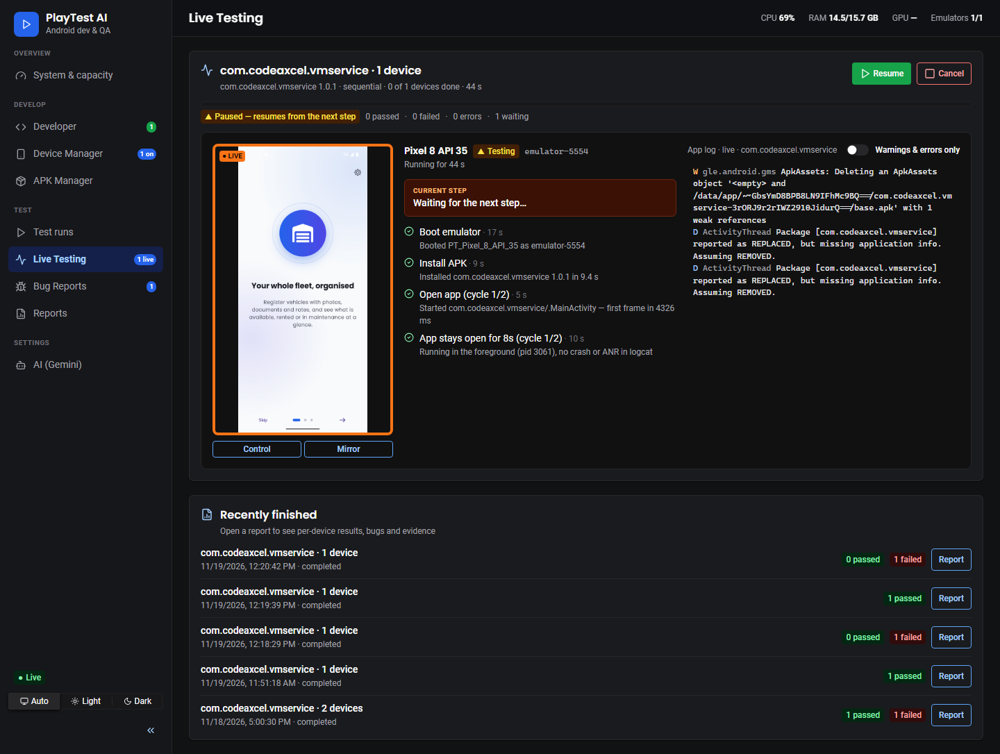
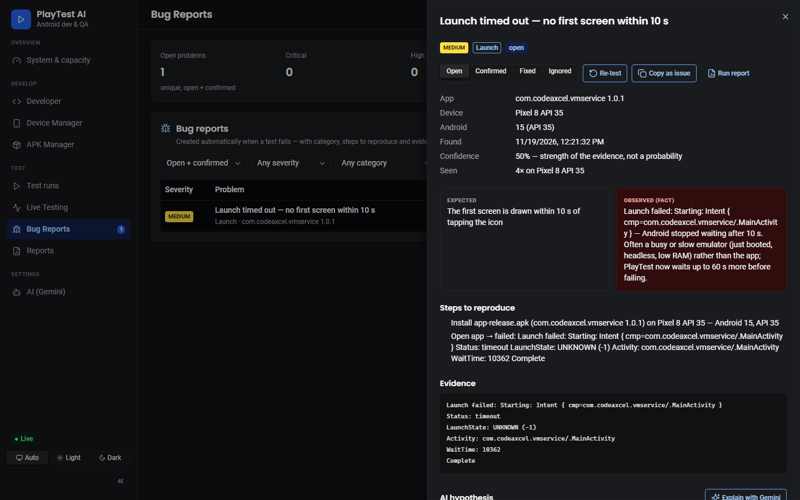
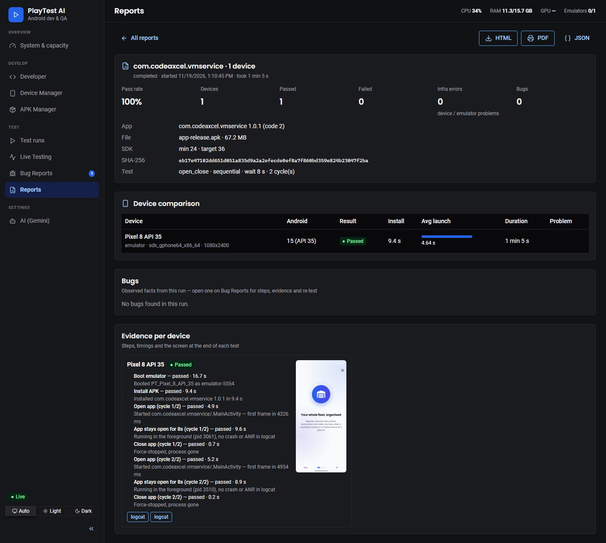
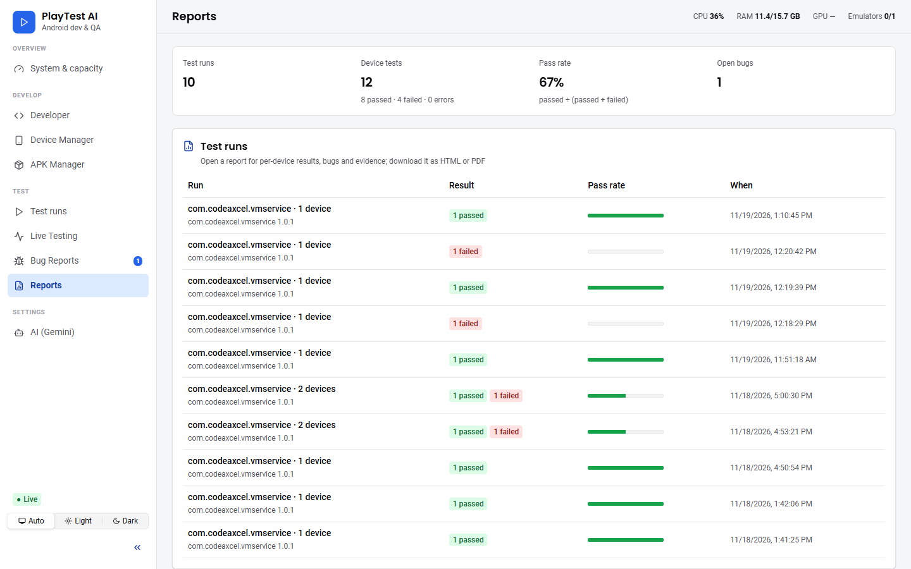
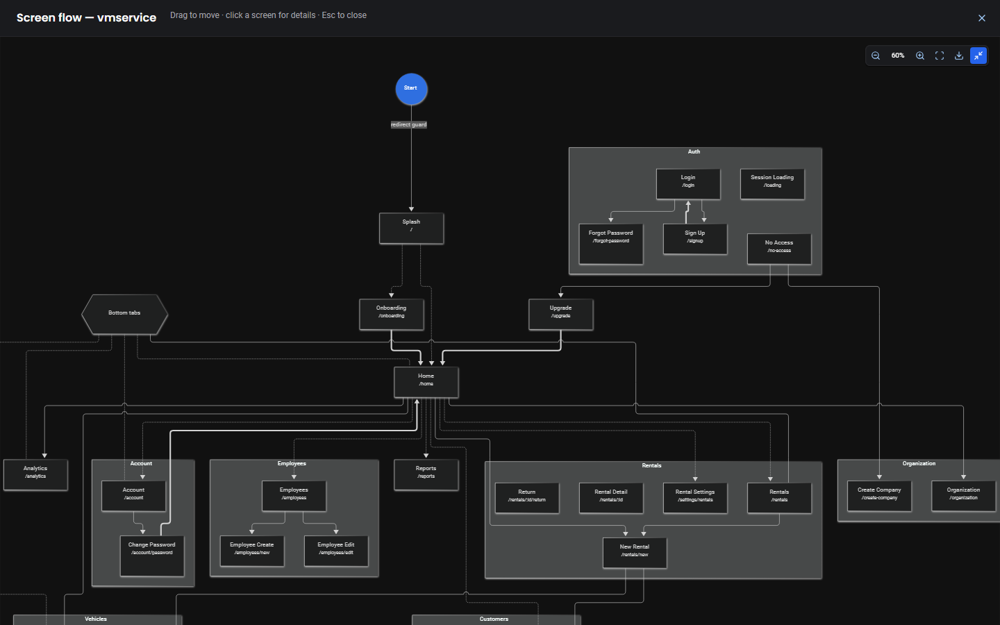
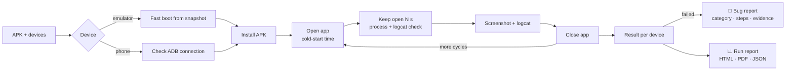

<div align="center">


# PlayTest AI

**Local-first Android QA and developer workbench.**
Test any APK on emulators and real phones, watch it live, get evidence-backed bug reports and shareable reports —
and build Flutter apps faster, all from one dashboard on your own PC.


[Features](#-features) · [Screenshots](#-screenshots) · [Quick start](#-quick-start) · [Configuration](#%EF%B8%8F-configuration) · [API](#-api) · [Roadmap](#%EF%B8%8F-roadmap)



</div>

---

## 📖 Table of contents

- [Features](#-features)
- [Screenshots](#-screenshots)
- [Quick start](#-quick-start)
- [How a test run works](#-how-a-test-run-works)
- [Configuration](#%EF%B8%8F-configuration)
- [Emulator speed](#-emulator-speed)
- [Connecting a phone](#-connecting-a-phone)
- [Storing emulators on another drive](#-storing-emulators-on-another-drive)
- [Google Gemini (optional)](#-google-gemini-optional)
- [Capacity rule](#-capacity-rule)
- [API](#-api)
- [Project layout](#-project-layout)
- [Roadmap](#%EF%B8%8F-roadmap)

---

## ✨ Features

### 🧪 Testing

| | Feature | What you get |
|---|---|---|
| ▶️ | **Test runs** | Pick an APK and any number of devices, one at a time or several at once. Each device: boot / connect → install → open (cold-start time) → keep open N s → check process + logcat for crash / ANR / native crash → screenshot + logcat → close, for N cycles. |
| 📡 | **Live Testing** | Every running test: live device screen, current step, step timeline, the app's live log, progress — **Pause**, **Resume**, **Cancel**, and tap / swipe / type on the device. |
| 🐞 | **Bug Reports** | Each failure becomes a bug with **category, severity, confidence, steps to reproduce, expected vs. observed and evidence** (screenshot, logcat, crash excerpt). The same problem on many devices is one row. **Re-test** (3 cycles, fresh install) marks it reproduced or not; **Copy as issue** gives GitHub/Jira Markdown; optional **Gemini hypothesis**, always labelled as unverified. |
| 📊 | **Reports** | Pass rate, device comparison across runs, and a per-run report — APK identity (version, SDK, SHA-256), per-device results, launch / install times, bugs and evidence — as **HTML**, **PDF** (print) or **JSON**. Saved automatically to `storage/campaigns/<id>/report/`. |

### 📱 Devices & emulators

| | Feature | What you get |
|---|---|---|
| 🧩 | **Device Manager** | 12 ready profiles, start / stop, health checks, installed AVDs, live ADB list, **Add as profile** for phones. |
| ⬇️ | **System images & AVDs** | Browse Google's catalog with download sizes, download with live progress, create AVDs (hardware + RAM) from the Developer page or Device Manager, one-click **Set up** for a profile. |
| 🧹 | **Free disk space** | See which AVDs use each system image and **delete unused images**; **Wipe data** resets an AVD and frees its user data and fast-boot snapshot (often 3–6 GB). |
| ⚡ | **Fast boot** | The first start saves a clean snapshot; later starts take **~5–10 s instead of 1–2 min**, always from a clean state with animations off. Stale lock files are cleared and a broken snapshot is re-saved by itself. |
| 📶 | **Boot progress 1 → 100 %** | Every view that shows an emulator shows its boot stage, percentage and time left (learned from its last boots) — never a black box. Screens keep their last frame while loading and offer **Wake screen** when the display is dark. |
| 🧠 | **RAM saver** | Device Manager → Memory: PC RAM per emulator and app, idle emulators, one-click stop, optional auto-stop of idle headless emulators. Per device: close background apps and cached processes to free RAM. |
| 👥 | **Play closed testing** | Track the 12 testers × 14 days Google Play needs before production: who is invited / opted in / left, the 14-day clock and the date you can apply, the opt-in link, a ready invite message, and the email list (CSV) for Play Console. Stored locally only. |
| 👻 | **Headless or windowed** | Test runs boot without a window; the Developer page lets you pick. Headless emulators are watched in the browser or with scrcpy, and **Stop** works for every emulator — even after a backend restart. |
| 📶 | **Phones over USB, Wi-Fi or QR** | Pair with a QR code or pairing code, switch a USB phone to Wi-Fi, restart ADB. |
| 💾 | **Any drive** | Keep AVDs and system images on another drive (e.g. `M:`), Android Studio keeps working. |

### 🛠️ Developer workspace

| | Feature | What you get |
|---|---|---|
| 🖥️ | **Live screen & mirror** | Click = tap, drag = swipe, type, keys, screenshot; smooth **scrcpy** window (one-click install). |
| 🐦 | **Flutter tab** | Project brief, **screen-flow diagram** (go_router, named routes, `push/go`, tabs) with full-screen view, **Run here** with hot reload / restart, screen details, state & data map, assets & strings, release checklist, `flutter doctor` with fixes, optional Gemini explanation. |
| 🔍 | **Device tools** | Info · Logcat (live, per app) · Apps (permissions, language, APK download) · Performance (CPU, memory, FPS, jank) · Files · Tools (deep links, quick settings, screen recording, emulator GPS / battery / network). |

### 🎨 Dashboard

Chakra UI with Auto / Light / Dark, collapsible sidebars, a phone-friendly layout, and a shared **TanStack Query** cache:
pages open instantly with the last data and refresh in the background, kept current by live server events.

---

## 📸 Screenshots

<table>
  <tr>
    <td width="50%"><p align="center"><b>Bug report</b> — facts, steps, evidence, re-test</p></td>
    <td width="50%"><p align="center"><b>Run report</b> — HTML / PDF / JSON export</p></td>
  </tr>
  <tr>
    <td width="50%"><p align="center"><b>Reports</b> — all runs and pass rates</p></td>
    <td width="50%"><p align="center"><b>Flutter screen flow</b> — full screen, drag to move</p></td>
  </tr>
</table>

---

## 🚀 Quick start

**Requirements (Windows 11)**

- Node.js **22.13+** (24 LTS recommended)
- Android Studio with SDK *platform-tools*, *emulator*, *build-tools* and an x86_64 Google APIs system image
- Virtualization (AMD-V / VT-x) enabled in BIOS and **Windows Hypervisor Platform** turned on
- Optional: NVIDIA driver (live GPU usage via `nvidia-smi`), Flutter SDK, scrcpy

```powershell
./scripts/setup.ps1          # npm install, .env, Appium + UiAutomator2
./scripts/create-avds.ps1    # optional: create the first 4 PT_* AVDs
npm run dev                  # API on :8000, dashboard on http://localhost:5173
```

Production mode: `npm run build && npm start` — the API then serves the dashboard at http://127.0.0.1:8000.

---

## 🔄 How a test run works



*failed* means the app misbehaved; *error* means a device or emulator problem (not counted as an app bug).
A launch that takes longer than Android's 10-second window is given up to 60 s more before it counts as a failure.

---

## ⚙️ Configuration

Everything lives in `backend/.env` (see `backend/.env.example`).

| Variable | Default | Meaning |
|---|---|---|
| `PORT` | `8000` | API port |
| `MAX_CONCURRENT_EMULATORS` | `1` | Emulators that may run at once |
| `EMULATOR_RAM_MB` | `2048` | RAM per emulator |
| `EMULATOR_CORES` | `0` (auto) | CPU cores per emulator — auto = half the host threads, 2–4 |
| `EMULATOR_IDLE_STOP_MINUTES` | `0` (off) | RAM saver: stop headless emulators nobody used for this long (never one with a window, a test run or `flutter run`) |
| `EMULATOR_GPU_MODE` | `host` | `host`, `swiftshader_indirect`, `angle_indirect`, `auto`, `off` |
| `EMULATOR_HEADLESS` | `true` | Test runs boot emulators without a window |
| `EMULATOR_FAST_BOOT` | `true` | Start from the clean `playtest_clean` snapshot |
| `DEVICE_BOOT_TIMEOUT_SECONDS` | `180` | Give up on a boot after this |
| `HOST_RESERVED_RAM_GB` | `4.5` | RAM kept free for Windows and other apps |
| `AVD_STORAGE_DIR` / `SYSTEM_IMAGES_DIR` | *(empty)* | Keep AVDs / system images on another drive |
| `FLUTTER_ROOT` / `SCRCPY_PATH` | *(auto)* | Tool locations when not on `PATH` |
| `GEMINI_API_KEY` / `GEMINI_MODEL` | *(empty)* / `gemini-3.5-flash` | Optional AI explanations |

---

## ⚡ Emulator speed

Device Manager → **Emulator speed** shows what is active on your PC (hardware acceleration, fast boot, cores, RAM, GPU).

- **Fast boot** — the first start of each AVD cold-boots once, turns animations off and saves `playtest_clean`.
  Every later start resumes it in seconds and never saves over it (`-no-snapshot-save`), so each test starts clean.
- Every emulator starts with `-cores N`, `-gpu host`, `-netfast`, `-no-audio` and `-no-boot-anim`.
- **Tips:** run one emulator at a time when RAM is above ~80 %; keep emulators running between runs (untick
  *Stop emulators after*); prefer x86_64 Google APIs images (Play Store images are heavier); keep AVDs on an SSD.
- If emulators are very slow, check **Windows Hypervisor Platform** in Windows Features — without it they run 5–10× slower.

---

## 📲 Connecting a phone

- **QR code (Android 11+)** — *Connect over Wi-Fi → QR code → Show QR code*. On the phone: Developer options →
  Wireless debugging → *Pair device with QR code* → scan. If it stays on "waiting", allow `adb.exe` through Windows
  Firewall on private networks.
- **USB** — Settings → About phone → tap *Build number* 7× → Developer options → *USB debugging* on → plug in →
  accept the prompt → **Add as profile**.
- **Wi-Fi pairing code (Android 11+)** — Developer options → *Wireless debugging* → *Pair device with pairing code*,
  then **Connect over Wi-Fi** in the dashboard.

Devices connected here also show up in `flutter run`, VS Code and Android Studio (one shared ADB server).

---

## 💾 Storing emulators on another drive

Device Manager → **Storage** → *Change folder* (e.g. `M:\Android\avd`). New AVDs are created there and *Move
existing AVDs* moves the current ones. The small `.ini` pointer files stay in `%USERPROFILE%\.android\avd`, so Android
Studio still sees every AVD (`AVD_STORAGE_DIR`).

**System images** can move too (*Use another drive*, `SYSTEM_IMAGES_DIR`): each image folder is moved and linked back
into the SDK with a directory junction, so sdkmanager, the emulator and Android Studio keep working. New downloads
unpack inside the SDK first (keep ~4 GB free there) and move automatically.

---

## 🤖 Google Gemini (optional)

1. Open https://aistudio.google.com/apikey and click **Create API key** (no billing needed).
2. Paste it on the dashboard's **AI (Gemini)** page, or set `GEMINI_API_KEY` in `backend/.env`.
3. Press **Send test prompt**.

Gemini is only used when you press an *Explain* button. Project explanations send the structure, never source code;
bug explanations send the bug's facts and log excerpt after you confirm. On the free tier Google may use prompts to
improve its products, so keep confidential data out of them.

---

## 📐 Capacity rule

```
per emulator   = EMULATOR_RAM_MB + ~0.75 GB host overhead, 2 CPU threads, ~250 MB VRAM
RAM limit      = (total RAM - HOST_RESERVED_RAM_GB) / per-emulator RAM
CPU limit      = threads / 2 - 1
GPU limit      = 85% of VRAM / 250 MB      (only with EMULATOR_GPU_MODE=host)
recommended    = min(RAM, CPU, GPU), at least 1 (sequential)
```

Ryzen 5 (12 threads) + GTX 1650 (4 GB): **8 GB → 1**, 16 GB → 3, 32 GB → 5 (then CPU-bound). These are estimates —
measure on your machine and adjust `HOST_RESERVED_RAM_GB` / `EMULATOR_RAM_MB`.

---

## 🔌 API

All endpoints are under `/api/v1`. Live updates arrive over Server-Sent Events at `/api/v1/events`.

<details>
<summary><b>Testing — runs, live, bugs, reports</b></summary>

| Method | Endpoint | Purpose |
|---|---|---|
| GET/POST | `/campaigns` | List runs / start one `{apk_id, device_ids, mode, concurrency, launch_wait_seconds, cycles, fresh_install, uninstall_after, stop_emulators_after}` |
| GET/DELETE | `/campaigns/:id` | Run detail (executions, steps, artifacts, `paused`) / delete |
| POST | `/campaigns/:id/cancel` · `/pause` · `/resume` | Cancel, or pause after the current step / resume |
| GET | `/campaigns/limits` · `/artifacts/:id` | Emulator slots / screenshot, logcat or crash file |
| GET | `/bugs?status=&severity=&category=&package_name=&campaign_id=` | Bug reports + open counts |
| GET/PATCH | `/bugs/:id` `{status}` | Bug with all occurrences / set open · confirmed · fixed · ignored (all occurrences) |
| POST | `/bugs/:id/retest` · `/bugs/:id/analyze` | Re-run on the same device (3 cycles) / Gemini hypothesis |
| GET | `/reports/overview` · `/reports/:id` | Totals and device comparison / one run's report data |
| GET | `/reports/:id/html[?download=1][&print=1]` | Self-contained HTML report (print = "Save as PDF") |

</details>

<details>
<summary><b>Devices, emulators and SDK</b></summary>

| Method | Endpoint | Purpose |
|---|---|---|
| GET/POST | `/devices` | List / create profile |
| POST | `/devices/seed` | Insert the 12 default profiles (only if empty) |
| PATCH/DELETE | `/devices/:id` | Update / delete profile |
| POST | `/devices/:id/start[?window=true\|false]` · `stop` · `health` | Emulator lifecycle and ADB health |
| POST | `/devices/:id/provision` `{accept_licenses: true}` | Download the image if needed + create the AVD |
| GET | `/adb/devices` · `/emulators/avds` · `/emulators/running` · `/emulators/speed` · `/tools` | Discovery, acceleration and speed settings |
| POST | `/adb/devices/:serial/emu-stop` | Stop any emulator, also ones started elsewhere |
| GET | `/emulators/boot` | Boot progress 0–100 %, stage and ETA (live: `boot_progress` events) |
| GET · POST · PUT | `/system/ram` · `/emulators/stop-idle` · `/emulators/settings` | RAM saver: PC memory per emulator/app, stop idle emulators, auto-stop minutes |
| GET · POST | `/adb/devices/:serial/memory` · `/adb/devices/:serial/memory/free` | Device RAM by group and app; close background apps |
| POST | `/adb/pair` `{address, code}` · `/adb/connect` `{address}` · `/adb/restart` | Wi-Fi debugging, ADB restart |
| POST/GET/DELETE | `/adb/qr-pair` · `/adb/qr-pair/:id` | QR pairing (SVG) / status / cancel |
| POST | `/adb/devices/:serial/profile` · `/disconnect` | Register a phone / drop a Wi-Fi link |
| GET | `/sdk/images/installed` · `/sdk/images[?refresh=true]` · `/sdk/device-definitions` | Installed images, catalog with sizes, hardware ids |
| POST | `/sdk/images/install` `{package, accept_licenses: true}` | Background download (progress via `sdk_job` events) |
| POST/DELETE | `/sdk/avds` · `/sdk/avds/:name` | Create (hardware, RAM) / delete AVD |
| POST | `/sdk/avds/:name/wipe` · `/sdk/images/uninstall` | Wipe an AVD's data · delete a system image (409 while AVDs use it, unless `force`) |
| GET · PUT · DELETE | `/play/apps` · `/play/:pkg` · `/play/:pkg/settings` | Closed-testing tracker per app: testers, 14-day clock, opt-in link |
| POST · PATCH · DELETE · GET | `/play/:pkg/testers` · `/play/:pkg/testers/import` · `/play/testers/:id` · `/play/:pkg/testers.csv` | Add / paste / update / remove testers; email list for Play Console |
| GET | `/sdk/jobs` · `/sdk/jobs/:id` | SDK job status and log |
| GET/PUT | `/sdk/storage` · `/sdk/storage/images` `{dir \| null}` | AVD and system image locations / move them |

</details>

<details>
<summary><b>Developer workspace and Flutter</b></summary>

| Method | Endpoint | Purpose |
|---|---|---|
| GET/POST | `/adb/devices/:serial/screen` · `/input` | PNG frame / tap, swipe, key, text |
| GET | `/devtools/flutter[?refresh=true]` · `/devtools/scrcpy` | Flutter SDK + its devices / scrcpy status |
| POST | `/devtools/scrcpy/install` · `/adb/devices/:serial/mirror` | Install scrcpy / open a mirror window |
| GET | `/adb/devices/:serial/info` · `/foreground` · `/apps[?system=true]` · `/apps/:pkg` | Device info, app in front, apps, app details |
| POST | `/adb/devices/:serial/apps/:pkg/{launch,stop,clear,uninstall,permission,locale}` | App actions |
| GET | `/adb/devices/:serial/apps/:pkg/apk` | Download the installed APK |
| POST | `/adb/devices/:serial/install` `{apk_id, launch}` · `/wireless` | Install from the library / USB → Wi-Fi |
| GET/POST | `/adb/devices/:serial/perf?pkg=` · `/perf/reset` | CPU / memory / frame counters |
| GET/POST | `/adb/devices/:serial/logcat?pkg=&tail=` (SSE) · `/logcat/clear` | Live logcat / clear |
| GET/POST | `/adb/devices/:serial/record` · `/record/start` · `/record/stop` | Screen recording |
| GET/DELETE | `/recordings` · `/recordings/:id` | Saved recordings |
| POST | `/adb/devices/:serial/deeplink` · `/emu` | Deep link / emulator GPS, battery, network, rotate |
| GET/PUT | `/adb/devices/:serial/toggles` | Quick settings |
| GET/POST/DELETE | `/adb/devices/:serial/files?path=` · `/files/download` · `/files/upload?dir=` | `/sdcard` file browser |
| GET/POST/DELETE | `/flutter/projects` `{path}` | Found + remembered Flutter projects |
| POST | `/flutter/analyze` · `/flutter/explain` `{path}` | Full project analysis / Gemini explanation |
| GET | `/flutter/doctor[?refresh=true]` | Parsed `flutter doctor -v` with fixes |
| POST | `/flutter/run` · `/flutter/terminal` `{path, serial}` | `flutter run --machine` / console window |
| GET/POST | `/flutter/runs` · `/runs/:id/stream` (SSE) · `/runs/:id/{reload,restart,stop}` | Run sessions and hot reload |

</details>

<details>
<summary><b>System, APKs and AI</b></summary>

| Method | Endpoint | Purpose |
|---|---|---|
| GET | `/health` | Health |
| GET | `/system/info` · `/system/metrics` · `/system/metrics/history` · `/system/metrics/daily` | Hardware and live / historic metrics |
| GET | `/system/capacity` · `/system/estimate?devices=&tests=&snapshot=` | Emulator capacity / run duration estimate |
| GET | `/events` | SSE: metrics, device, SDK job, campaign, execution and bug events |
| POST | `/apks/upload` | Multipart field `file` |
| GET/DELETE | `/apks` · `/apks/:id` | APK library |
| GET/PUT | `/llm/status` · `/llm/config` `{api_key?, model?}` | LLM status (key never returned) / save key + model |
| GET/POST | `/llm/models` · `/llm/test` `{prompt?}` | Models the key can use / round-trip test |

</details>

---

## 🗂️ Project layout

```
backend/src/
  main.ts                 Fastify bootstrap, emulator re-attach, static dashboard, graceful shutdown
  config.ts               Zod-validated env
  db/                     node:sqlite + migrations
  api/                    system, devices, apks, sdk, llm, campaigns, bugs (+ reports), devtools, devkit, flutter
  services/               system-monitor, capacity, devices, apks, campaigns, bugs (classifier), reports (JSON + HTML)
  automation/             adb, emulator (fast boot, re-attach, stop), sdk-manager, campaign-runner (pause/resume),
                          devkit, devtools, flutter-project, flutter-insights, flutter-run
  llm/                    provider contract, Gemini adapter
  core/events.ts          event bus → SSE
dashboard/src/
  pages/                  System, Developer (+ dev/ workspace tabs, Flutter, MermaidView), Device Manager
                          (+ devices/ ADB, SDK, Storage, Speed), Test runs, Live Testing, Bug Reports, Reports, APKs, AI
  components/             ui kit (Card, Badge, Stat, Notice, Empty, Loading, Kv, CopyButton), SectionNav, toaster
  lib/                    api client + types, useLive (SSE), queries (TanStack Query cache + live sync)
docs/                     logo and screenshots for this README
scripts/                  setup.ps1, create-avds.ps1, start-appium.ps1
```

---

## 🗺️ Roadmap

| Phase | Deliverable | Status |
|---|---|---|
| 0 | Foundation — API, dashboard, SQLite, migrations | ✅ |
| 1 | APK management — upload, validate, metadata | ✅ |
| 2 | Device manager — profiles, boot, health, SDK images, phones | ✅ |
| 3 | Manual automation — Appium session and approved actions | 🔜 |
| 4 | Campaign engine — APK × devices, sequential / parallel | ✅ (open & close flow) |
| 5 | Evidence & Live Testing — screenshots, logcat, step results, live view | ✅ |
| 6 | AI planner — requirements → reviewable test plan | 🔜 |
| 7 | AI explorer — bounded UI exploration and navigation map | 🔜 |
| 8 | Bug analysis — category, reproduction, evidence | ✅ |
| 9 | Reports — dashboard and HTML / PDF output | ✅ |
| 10 | Hardening — recovery, tests, packaging | 🚧 (emulator re-attach, interrupted-run recovery) |

<div align="center">
<sub>Built with Node.js, Fastify, React and Chakra UI · runs entirely on your PC</sub>
</div>
